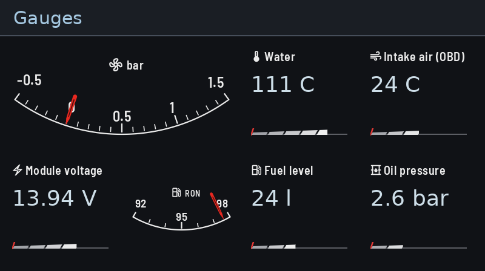
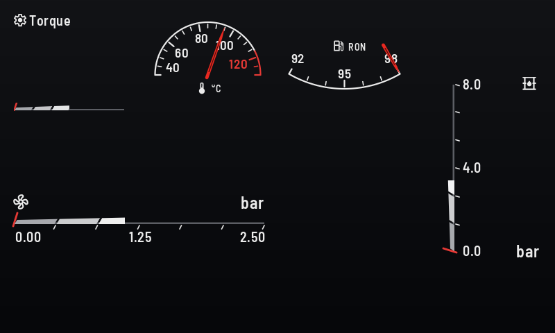
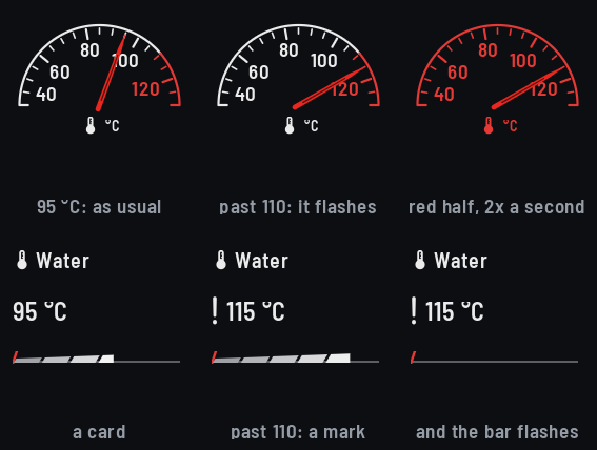

<div align="center">

# EntryNav2 Android Auto 800x480

**Android Auto, gauges and a camera view for BMW's EntryNav2 head unit with the 800x480 screen, in F-series cars.**

[](LICENSE.md)



</div>

> [!WARNING]
> Experimental software that writes to the car's head unit, tried on **one car** (an F22, below). It is not affiliated
> with BMW or Google. Read [Status](#status) and the [disclaimer](#licence-and-disclaimer) first.

This project started as a fork of [Jiraiya43/EntryNav2-Android-Auto](https://github.com/Jiraiya43/EntryNav2-Android-Auto)
and has grown into its own: three iDrive apps for an F-series car with the small screen and no navigation. Its Android
Auto core is still upstream's work, and several other projects gave code or showed the way:
[every one of them is listed below](#projects-this-one-builds-on), and file by file in
[docs/ORIGINS.md](docs/ORIGINS.md).

## What it does

**Android Auto** (iDrive app *EntryAad*)

- Over the USB cable or wirelessly (the unit's own Wi-Fi, started over Bluetooth), on the 800x480 screen, with the
  iDrive controller, its keys, the volume and the car's microphone.
- Takes the phone back from the media player, which claims every phone in accessory mode on this car.
- Album covers on the entry's preview card; OPTION opens Android Auto's own panel (*Show map buttons*, *Tap the map*:
  this car has no touch screen).
- Leaves the screen to the rear camera in reverse and comes back after it; driving mode changes do not stall it; a
  session that drops while you are in another iDrive app reconnects without taking the screen back.
- The older 5-key controller as well as the newer one.

**Gauges** (iDrive app *CarGauges*, under My Vehicle)

- Three dashboards of 2 x 4 cells. Each gauge has a look: a card (number and bar), a dial, a fuel-gauge arc, a wide bar,
  wide dial or wide arc over two cells, or a tall bar over two cells. Drawn as BMW's current M5 cluster: thin scales,
  a red start mark and red end zone, red slotted needles, the icon and unit on the gauge.
- 62 values: the iDrive's own car data (water and oil temperature, torque, rpm, speed, fuel, trip values...), standard
  OBD values and BMW engine values from the DME (boost, rail pressure, lambda, the adapted fuel quality as RON
  92 / 95 / 98...).
- *Gauge settings*: choose the gauges (by source), their looks, **where each goes** on the dashboards, and **their
  min and max**, set by hand; the dial or bar is redrawn on the head unit with the new scale. Needles move smoothly.
- **Alerts**: a value per gauge past which it flashes red; its red zone starts there
  ([how to set one, and how it looks](docs/SETTINGS.md#gauges)).
- A shift light, the engine's fault codes with descriptions (and a clear that asks first), Live values, and a
  *Car tests* page whose results show on screen, for checks at the car.

The looks a gauge can take (*Gauge styles*) — a card, a dial, a fuel-gauge arc, a wide bar and a tall bar:



An alert (here Water over 110 °C): as usual below it, flashing red past it; a card marks it with ! and its bar flashes
red:



**Camera** (iDrive app *AuxCamera*, under My Vehicle)

- The picture of an analog camera through a USB video grabber (EasyCap, MacroSilicon 534d:0021), full screen, up to
  25 pictures a second. The kernel has no UVC driver: the app reads the grabber through usbfs itself.

**6WA cluster arrows** (work in progress)

- Android Auto's next maneuver worked out for the F-series 6WA cluster's MOST HUDTerminal (arrow, junction view,
  street, distance), following NBT-AAD's driver and guidance rules, and optionally the song playing while no turn is
  shown. Logged only for now: the cluster does not draw them yet (see Status).

## Status

On [the test car](#the-test-car), 2026-11-27:

| Feature | State |
|---|---|
| Android Auto over USB: picture, sound, controller, keys, volume | **works** |
| Android Auto wireless | **works**, but dropped often (now with an added Wi-Fi antenna); upstream's Wi-Fi fixes are installed, not yet checked |
| Album covers | **works** |
| Gauges: dashboards, looks, places, car data values | **works** |
| Gauges: engine values (DME, OBD) | **works** (boost, oil pressure, fuel quality, module voltage shown, 2026-11-27) |
| Gauges: hand-set ranges, smooth needles | **works** |
| Gauges: alerts | **works**; the flash should stand out more (next change) |
| Engine fault codes, read and clear | built, car check pending |
| Camera app | **works** (picture shown); the full-screen view not yet checked |
| Arrows in the 6WA cluster | **does not work yet** |

Every change is tested on a PC first, and the ARM programs run under QEMU against the car's own libraries; only a car
test counts as proof.

**Engine values.** The Gauges app reads the DME through the car's diagnostic gateway (HSFZ, read services only). On
the test car this worked several times, then stopped answering although the head unit's firewall rules were in force;
the gateway probably opens its Ethernet only while a diagnostic (ENET) cable is plugged into the OBD port. The head
unit's own diagnosis tunnel over MOST answered the DME at the same time (coolant, rpm), so the app now reads the
engine through that tunnel whenever the gateway does not answer (clearing the fault codes still needs the gateway).

**6WA arrows.** The cluster answers the head unit's read requests over MOST but has ignored every drawing call so far
(any message layout or channel). On 2026-11-27 upstream's own MOST arrows found the cluster's guidance fields but got
no answer to any of their size requests, and a stand-in navigation registered by the head unit got iDrive asking it
questions for the first time while the cluster still stayed silent. The car has no navigation, and the cluster's
display settings offer only the current speed: the next test tells whether the cluster ignores the calls or its
answers never come back.

**Not available on this car:** car GPS (no navigation: Android Auto uses the phone's GPS), a head-up display, touch.
The retrofitted console's 360 camera button has no camera behind it; the plan is to open the Camera app with it.

## The test car

| | |
|---|---|
| Car | BMW 230i Coupé (F22), 2019, manual gearbox, engine software as from the factory |
| Head unit | EntryNav2 (*EntryEvo*, Linux), 800x480 screen, **no navigation**, no touch screen |
| Controller | the older iDrive controller |
| Cluster | **6WA** (analog dials with a colour screen between them) |
| Phone | Android |

## Requirements

- An F-series BMW with an **EntryNav2** head unit (*EntryEvo* inside its system) and the **800x480** screen.
- An Android phone with Android Auto, a USB cable (or the wireless mode).
- A PC with an SSH client, an **ENET cable** (OBD to Ethernet) and the head unit's **root password** (not provided
  here).

NBT, NBT Evo, ID7 and MGU head units run other systems: this project cannot run on them. G-series cars are better
served by upstream.

## Installing

Full steps for a car that has never been opened to SSH are in [docs/INSTALL.md](docs/INSTALL.md), and the settings
and logs in [docs/SETTINGS.md](docs/SETTINGS.md). In short, build the archive ([Building](#building-from-source)),
then over SSH: copy `entrynav2-android-auto-<version>-armhf.tar` to the unit's `/tmp`, unpack it and run its
`install.sh` (read-only checks, backup, verified copy of `/opt/aa`, the three plugin folders under
`/opt/hmi/data/ro/Plugins` and the firewall rules, restore if a copy fails), and restart the unit. Later versions
can also come from a USB stick through Android Auto's menu, when signed with this project's key.

`reboot` does nothing on this unit; `systemctl --force reboot`, run in the foreground, restarts it. Holding the volume
knob about 30 s, or disconnecting the battery, works too.

### Settings

Each is a file in `/var/local/data/AA`; the apps write most of them from their own menus.

| File | Effect |
|---|---|
| `usb` | the USB port Android Auto uses (e.g. `3-1`) |
| `usb-takeover` | take the phone back from the media player |
| `option-key` | what *Show map buttons* does: `nudge` (default), `tap`, or a key code |
| `kombi-6wa`, `kombi-6wa-live` | work out the 6WA arrows and log them; also send them (experimental, parked only) |
| `kombi-6wa-approach`, `kombi-6wa-lanes`, `kombi-6wa-junction-off`, `kombi-anydist` | the arrows' rules |
| `kombi-6wa-media` | the song playing in the 6WA's street line while no turn shows |
| `kombi-most-on` | upstream's own MOST arrows (they send to the cluster by themselves; off by default) |
| `gauges-off`, `camera-off` | hide the Gauges or the Camera app |
| `gauges-choice`, `gauges-style`, `gauges-place`, `gauges-limits`, `gauges-alerts` | the gauges shown, their looks, places, ranges and alerts |
| `gauges-dme-off`, `gateway-ip` | no engine values; the diagnostic gateway's address |
| `camera-size`, `camera-view` | the camera's picture size and view |

Settings and logs: [docs/SETTINGS.md](docs/SETTINGS.md). Logs: `/tmp/entry-aa-service.log` (Android Auto service), `/var/local/data/AA/app.log` (iDrive apps),
`/var/local/data/AA/car-tests.log` (Car tests), `/var/local/data/AA/gauge-collector.log` (engine values).

## Building from source

You need Docker, and for the ARM build **a copy of the car's system** (`HU_ROOTFS`). That copy holds BMW files: it
never goes into git. Without it, the PC tests still run.

```sh
make check                                              # style, content checks, PC tests
docker build -t entrynav2-tc:4.7 toolchain              # once: GCC 4.7 for ARMv7 hard-float
bash toolchain/tc.sh make -j4 all hmiapp test-arm-all   # ARM programs, linked against the car's libraries
python3 -I tests/run_qemu.py                            # ARM tests under QEMU with the car's libraries
python3 tools/package_release.py                        # artifacts/entrynav2-android-auto-<version>-armhf.tar
```

## Repository layout

```text
core/        Android Auto protocol: session, TLS, fragments, car description
platform/    EntryNav2 specifics: video, input, USB, Wi-Fi, cluster (hudterm*, hud6wa, kombi_*), diagnostics (hsfz)
hmiapp/      the iDrive apps: EntryAad (Android Auto), CarGauges (Gauges), AuxCamera (Camera), and their pictures
tools/       supervisor, car-test, gauge-collector, uvc-probe, release packaging and checks
tests/       PC tests and ARM tests under QEMU
toolchain/   Docker image of the cross compiler
docs/        INSTALL, SETTINGS, ARCHITECTURE, and ORIGINS (what comes from where)
```

## Projects this one builds on

This project exists because the people below did the hard work and shared it. Thank you.

**Code taken or ported**

| Project | Licence | What this project has from it |
|---|---|---|
| [Jiraiya43/EntryNav2-Android-Auto](https://github.com/Jiraiya43/EntryNav2-Android-Auto) (formerly entry-aad), by Jiraiya43 | PolyForm Noncommercial 1.0.0 | The base: the Android Auto protocol and session, the service, the EntryAad iDrive app, USB and wireless modes, the build, packaging and tests. Most of the Android Auto code is theirs. They accept [GitHub Sponsors](https://github.com/sponsors/Jiraiya43); this project asks for nothing. |
| [Sq00ky/Supra-iDrive6-Android-Auto](https://github.com/Sq00ky/Supra-iDrive6-Android-Auto) (NBT-AAD), by nanaisu | PolyForm Noncommercial 1.0.0 | The project upstream started from. Its F-series 6WA cluster driver (MOST HUDTerminal: protocol, maneuver pictures, layout), with tom-pryor's guidance rules and junction view (#157, #162), *directions at any distance* (#205) and pstryju's fragment fix (#223), and bejusxd's song title in the 6WA (#288). |
| [inotbarnacle/ID6_apps_prerelease](https://github.com/inotbarnacle/ID6_apps_prerelease) (ID6 apps), by inotbarnacle | MIT | The DME fault code descriptions (unchanged) and engine identifiers; the Gauges app's approach (BoostDeck's cards and tall bar, pre-drawn bars, a worker process for diagnostics); the MOST diagnosis tunnel's message format. |
| [CallMeLewis/EntryNav-Apps](https://github.com/CallMeLewis/EntryNav-Apps), by CallMeLewis | MIT | The three firewall rules that open the diagnostic gateway's ports on EntryNav2, and the fault code clear's sequence. |
| [BimmerGestalt/AAIdrive](https://github.com/BimmerGestalt/AAIdrive), by the BimmerGestalt team | MIT | The iDrive car data (CDS) paths the Gauges app reads, as its `CDSMetrics.kt` reads them. |
| [jpt/barlow](https://github.com/jpt/barlow) (Barlow typeface) | SIL Open Font License 1.1 | The gauges' figures and names, rendered once from Barlow Semi Condensed SemiBold into a picture sheet (the font itself is not included). |
| [google/material-design-icons](https://github.com/google/material-design-icons) (Material Symbols) | Apache License 2.0 | The gauges' icons, rendered once from Material Symbols Outlined into a picture sheet. |

**Referenced** (read for how things work; no code taken)

| Project | What it showed |
|---|---|
| [JayJay3071/nbt-android-auto](https://github.com/JayJay3071/nbt-android-auto), `docs/CLUSTER-HUDTERMINAL.md` | The cluster's HUDTerminal functions, used by the on-car cluster tests. |
| [NBT-AAD pull request #264](https://github.com/Sq00ky/Supra-iDrive6-Android-Auto/pull/264) (FreZZZeR) | How a 6WA answers the drawing calls (its image sizes, the copies of its answers), for the cluster work. |
| [niz93/nbtevo-carplay-advanced-f5x-6wb-only](https://github.com/niz93/nbtevo-carplay-advanced-f5x-6wb-only), MINI F5x research | That a MINI F56 cluster drew CarPlay's guidance once the calls used the factory navigation's transmission type 4, for the cluster work. |
| [gediz/bmw-unified-db](https://github.com/gediz/bmw-unified-db) | The source of ID6 apps' fault code summaries (DME8xx), used here through ID6 apps. |
| NBT-AAD's open branches and ID6 apps' other apps | Reviewed for what fits this car; what was left out, and why, is in [docs/ORIGINS.md](docs/ORIGINS.md). |

Required Notices, kept as the PolyForm licence asks:

Required Notice: Copyright (c) 2026 Jiraiya43 - EntryNav2 (EntryEvo) Android Auto (formerly entry-aad)

Required Notice: Copyright (c) 2026 nanaisu - NBT-AAD (https://github.com/Sq00ky/Supra-iDrive6-Android-Auto)

The MIT notices are kept in the files taken from those projects (for example `platform/dme_gauges.hpp`,
`platform/dme_codes.hpp`); [docs/ORIGINS.md](docs/ORIGINS.md) says which file comes from where.

## Licence and disclaimer

Under the [PolyForm Noncommercial License 1.0.0](LICENSE.md), as the code it builds on: any noncommercial use,
including modifying and sharing, as long as the licence goes with every copy. Commercial use is not allowed.

The software comes as is, without any warranty. Installing it modifies the head unit's system and may affect your
warranty. Use it only on a car you own or with its owner's consent, with the car parked during installation and
tests, and never operate the head unit's shell while driving. Diagnostics only read, except the fault code clear you
start yourself.

BMW and iDrive are trademarks of BMW AG; Android and Android Auto are trademarks of Google LLC. This project is not
affiliated with, endorsed or sponsored by either.
