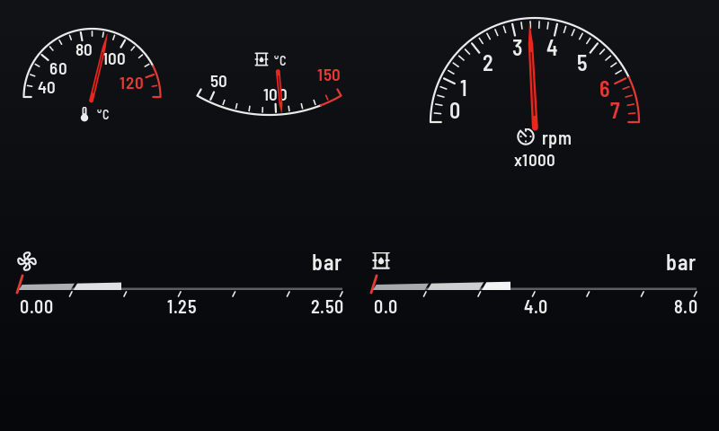
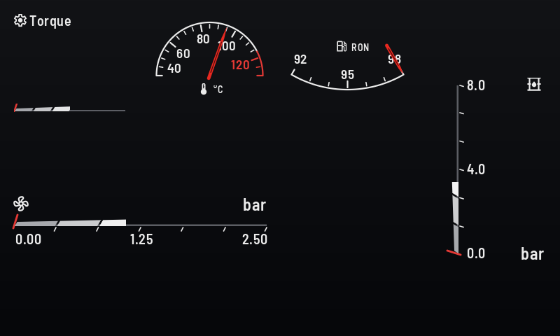

# Installing

From a car that has never been opened to Android Auto, Gauges and Camera on its iDrive. About an hour the first time,
ten minutes for an update.

> [!CAUTION]
> Car parked, ignition on, for the whole procedure (a battery charger helps). Do not switch the ignition off while
> the installer runs. Everything here is at your own risk: it changes the head unit's system.

## 1. Check the car

You need an **EntryNav2** head unit (BMW calls it *EntryEVO* inside) with the **800x480** screen: the small iDrive
screen of F-series cars without the Professional navigation. Your coding tool names the head unit *HU-B* or
*EntryNav2*; once SSH works (step 3), `head -n 1 /etc/version` on the unit shows its software date, such as
`201910211433`.

NBT, NBT Evo, ID7 and MGU head units run other systems: this project cannot run on them. G-series cars and the
1280x480 screen are better served by [upstream](https://github.com/Jiraiya43/EntryNav2-Android-Auto).

## 2. What you need

| | |
|---|---|
| A PC | Windows 10 or 11 (its built-in `ssh` and `scp` are enough), Linux or macOS |
| An **ENET cable** | OBD port to the PC's Ethernet port (the cable sold for BMW coding) |
| **SSH unlocked** on the head unit | once per car: step 3 |
| The head unit's **root password** | not published here (step 3) |
| The release archive | `entrynav2-android-auto-<version>-armhf.tar` from this repository's releases, with its `.sha256` |
| A phone | Android with Android Auto; a USB cable, or nothing for wireless |

## 3. Unlock SSH (once per car)

A head unit from the factory does not accept SSH logins. How owners open it is documented by the open-source
community, not by this project — follow their guides, at your own risk. This project does not unlock the unit, and
needs only that SSH already works (step 4).

What the community reports (BMW coding forums, and the EntryEvo thread
[NBT-AAD #86](https://github.com/Sq00ky/Supra-iDrive6-Android-Auto/issues/86)):

- SSH is enabled by an **activation code tied to the car's VIN**, written to the unit over the ENET cable with a BMW
  coding tool. The free "Bavarian" SSH tool is reported **not** to work on EntryNav2/EntryEvo, so a code is needed.
- Once SSH is on, you log in as **root**. EntryNav2 units are known to share a **default root password**; the
  community threads above state it. For that reason, treat SSH on the unit as unprotected and keep the OBD port in
  your own hands. This project does not store or change that password (see [SECURITY.md](../SECURITY.md)).

## 4. Connect

```sh
ssh -o HostKeyAlgorithms=+ssh-rsa root@169.254.1.0
```

`169.254.1.0` is the head unit's usual address on the ENET cable; if it does not answer, your coding tool shows the
unit's address. The unit's SSH server is old: without `-o HostKeyAlgorithms=+ssh-rsa` a recent PC refuses it. Type
`exit` to leave.

## 5. Install

On the PC, in the folder holding the archive (put your version in place of `<version>`):

```sh
scp -O -o HostKeyAlgorithms=+ssh-rsa entrynav2-android-auto-<version>-armhf.tar root@169.254.1.0:/tmp/
ssh -o HostKeyAlgorithms=+ssh-rsa root@169.254.1.0
```

Then on the head unit:

```sh
cd /tmp && tar -xf entrynav2-android-auto-<version>-armhf.tar && cd entrynav2-android-auto-<version>
sh install.sh
```

The installer checks first and changes nothing if a check fails: the files of the archive, free space, that every
library and function it needs is on this unit, and a dry run of Android Auto's start. Then it saves what it replaces,
copies, checks every copied file, and puts the saved files back if one is wrong. It ends with `RESULT ok`, or says
what stopped it.

Then restart the head unit:

```sh
systemctl --force reboot
```

The screen goes dark and iDrive comes back in about a minute and a half.

## 6. First start

| Where | What |
|---|---|
| *Media* → *Android Auto* | Android Auto's menu. Wireless: pair the phone over Bluetooth if it is not yet, accept the car on the phone. USB: tick *USB cable instead of wireless* and plug the phone in. |
| *My Vehicle* → *Gauges* | the dashboards; OPTION → *Gauge settings* to choose the gauges, their looks, places and ranges |
| *My Vehicle* → *Camera* | a USB video grabber's picture, if one is plugged in |

The Gauges dashboard (a rendering of the app's own gauges; the real screen looks the same):



The gauge looks you can pick in *Gauge styles* — a card, a dial, a fuel-gauge arc, a wide bar and a tall bar:



## Updating

Steps 5 and 6 with the new archive. Your settings (`/var/local/data/AA`) stay.

Once a version with it is installed, later releases can also come from a USB stick: copy the archive onto the stick,
plug it into the car, Android Auto's menu → *Update from USB stick* (a second press installs). Only archives signed
with this project's key are taken; the rest install by SSH as above.

## Uninstalling

On the head unit, from the folder of the installed version's archive:

```sh
sh install.sh --uninstall
systemctl --force reboot
```

## If something goes wrong

| What you see | What to do |
|---|---|
| `ssh`: *no matching host key type* | add `-o HostKeyAlgorithms=+ssh-rsa` (step 4) |
| `scp`: *subsystem request failed* | add `-O` |
| The installer stops at a check | nothing was changed; send its output in an issue |
| No *Android Auto* in Media, or no *Gauges* in My Vehicle | restart the head unit again: iDrive reads its apps only at start |
| iDrive restarts several times after the install | the app stops itself after the third quick restart; run `sh install.sh --uninstall`, restart, and open an issue |
| The screen does not respond | hold the volume knob about 30 seconds: the head unit restarts |

Settings, logs and the engine values: [SETTINGS.md](SETTINGS.md).
