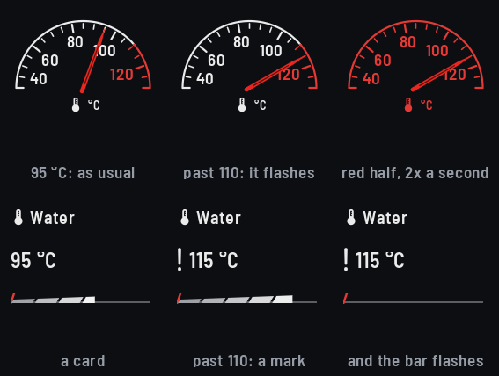

# Settings, logs and engine values

Most things are set from the apps' own menus. Everything is also a small file in `/var/local/data/AA` on the unit:
without the file the feature is off or at its default. Edit them over SSH ([INSTALL.md](INSTALL.md)); a change to an
Android Auto setting takes effect at its next start (its menu: *Stop*, then *Start*).

## Android Auto

| File | Effect |
|---|---|
| `vehicle` | Model and year shown to the phone: `model=…` and `year=…`, one per line. Without it: "iDrive", 2019 |
| `usb` | Android Auto over the USB cable instead of wireless (the menu's *USB cable* box). Empty, or the one port to watch, e.g. `3-1` |
| `autostart` | Android Auto starts with iDrive (the menu's *Auto start* box) |
| `entry-direct` | The *Android Auto* line opens Android Auto directly, not its menu |
| `option-key` | What *Show map buttons* sends: `nudge` (default), `tap`, or a key code |

## 6WA cluster arrows (experimental)

The arrows are worked out from the phone's guidance; whether the cluster draws them is still open
([README](../README.md#status)).

| File | Effect |
|---|---|
| `kombi-6wa` | work out the 6WA arrows and log them |
| `kombi-6wa-live` | also send them to the cluster — experimental, only with the car parked |
| `kombi-6wa-approach` | when a maneuver shows: `time [warn s [main s]]` (default 50 s / 20 s), `distance`, or `off` |
| `kombi-6wa-lanes`, `kombi-6wa-junction-off` | lanes on; the junction view off |
| `kombi-anydist` | show the next maneuver at any distance |
| `kombi-6wa-media` | the song playing in the cluster's street line while no maneuver shows (it hides the cluster's on-board computer line meanwhile) |
| `kombi-most-on` | upstream's own MOST arrows (they read the cluster's fields and draw by themselves); off by default, as they send to the cluster |

## Gauges

Set from *My Vehicle* → *Gauges* → OPTION → *Gauge settings*: *Choose* (by source), *Gauge styles*, *Gauge places*,
*Gauge ranges*. They are saved in `gauges-choice`, `gauges-style`, `gauges-place`, `gauges-limits`. Without them the
first dashboard shows Boost, Water, Intake air, Module voltage, Fuel quality, Fuel level and Oil pressure.

**Alerts.** A value per gauge past which it warns you. To set one: *My Vehicle* → *Gauges* → OPTION → *Gauge
settings* → *Gauge ranges* → press the gauge. Under its range, *Alert +* and *Alert -* move the alert value in a big or
a small step (the first press puts it at 90 % of the range), and *No alert* removes it. The page's first line says the
value; *Gauge ranges* lists it next to each gauge. Saved in `gauges-alerts`.

How it shows (here Water, alert over 110 °C):

- **Below the alert** the gauge is as usual, but its red zone now starts at the alert value, so you see where it is.
- **Past the alert** the dial, arc or bar flashes: all red, then as usual, twice a second, for as long as the value
  stays past it. A card puts **!** before its number and its bar flashes; *Live values* adds "! over 110".



| File | Effect |
|---|---|
| `gauges-off` | hide the Gauges app |
| `gauges-dme-off` | do not read the engine (DME/OBD) values |
| `gateway-ip` | the diagnostic gateway's address, if the app's search does not find it |

### Engine values

Water and oil temperature, torque, rpm, fuel and the trip values come from the iDrive's own car data and always
work. Boost, rail pressure, lambda, the OBD values and the fuel quality come from the engine computer (DME), read
two ways:

- **Through the diagnostic gateway** (HSFZ) when it answers. On the test car the gateway answered only while a
  diagnostic (ENET) cable was in the OBD port.
- **Through the head unit's MOST tunnel** when the gateway does not answer, so the values work without a cable.

*Diagnostics* in the Gauges menu shows which path is in use. Reading is all it does; the one thing that writes is
clearing the fault codes, which asks first and needs the gateway.

## Camera

*My Vehicle* → *Camera* shows a USB video grabber's picture (EasyCap, MacroSilicon 534d:0021). OPTION picks the view
(fill the screen, keep proportions) and the picture size. `camera-off` hides the app; `camera-size`, `camera-view`
hold the choices.

## Logs

Nothing is logged without the `maintenance` file: the Android Auto menu's *Keep logs* box sets it, and *Copy logs to
USB stick* copies them onto a stick in the car's USB port, no SSH needed. To look into a problem: turn logs on,
reproduce it, fetch them, turn them off.

```sh
touch /var/local/data/AA/maintenance
```

| Log | Where |
|---|---|
| iDrive apps (Android Auto entry, Gauges, Camera) | `/var/local/data/AA/app.log` |
| Android Auto service | `/tmp/entry-aa-service.log`, and `/var/local/data/AA/service.log` kept across the car's sleep |
| Car tests page | `/var/local/data/AA/car-tests.log` |
| Engine values | `/var/local/data/AA/gauge-collector.log` |

Fetch from the PC:

```sh
scp -O -o HostKeyAlgorithms=+ssh-rsa root@169.254.1.0:/var/local/data/AA/app.log .
```

Turn logs off again:

```sh
rm -f /var/local/data/AA/maintenance /var/local/data/AA/app.log /tmp/entry-aa-service.log
```

## If an app keeps iDrive restarting

If iDrive crashes three times within 15 minutes, each time shortly after loading the Android Auto app, the app stops
itself and iDrive comes up without it; it comes back by itself once those crashes are 15 minutes old. A restart of
the whole unit (coding, the volume knob, ignition) does not count. To re-enable it at once, after fixing the cause:

```sh
rm -f /var/local/data/AA/app.disable /var/local/data/AA/app-guard
systemctl --force reboot
```

## Is it running

```sh
ls -la /opt/aa /opt/hmi/data/ro/Plugins
grep -c libEntryAad /proc/$(pidof HmiMain3D)/maps   # more than 0: iDrive loaded the Android Auto app
pidof aa-supervisor entry-aad                       # Android Auto running
```
